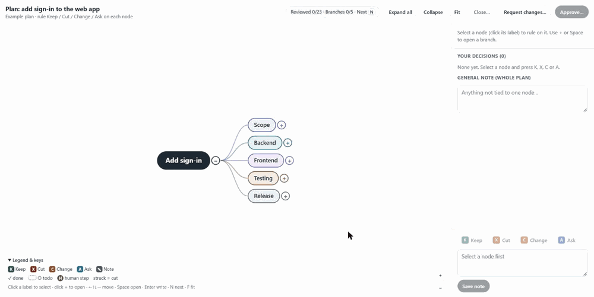

# Canopy

**Cut the plan, not the code.** A tree-shaped review and approval gate for Claude Code. Claude writes its plan as a tree, the tree opens as a collapsible map in your browser, you rule **Keep / Cut / Change / Ask** on any node, and your decisions come back into the same session before any code is written.



- **Per-node decisions**, one key each: `K` Keep, `X` Cut, `C` Change, `A` Ask, plus optional text.
- **Approval gate** (`--gate`): Approve unlocks once every top-level branch has a decision (Keep, Cut, Change or Ask on the branch or anything in it). Opening branches or Expand all does not count, so there is no blind "approve all". With Cut, Change or Ask decisions it becomes **Approve with notes**.
- **Review rounds**: the same plan keeps the same link. On round 2 every unchanged node keeps your decision (matched by node id, even if Claude moved it), only added or changed nodes need a look, the panel shows the old text and what you said, and removed nodes are listed with Claude's reason. One click filters to "Changed since last round".
- **Structured output** with stable node ids (`--json`), or Markdown for a quick read.
- **Local and offline.** Python standard library and a bundled d3. No CDN, no web fonts, no telemetry. The page is served only on `127.0.0.1`, behind a per-session token.
- **Drafts survive** a reload, a closed tab, a timeout or a re-run.
- **Light and dark themes** that follow your system (or press `T`), with decision colours that keep the same meaning and contrast in both.

### Why a tree, not line comments
Most plan reviewers annotate text. Canopy decides on scope: one decision per node, and a decision on a branch covers everything under it, so cutting a whole area is one key. Decisions come back as JSON with stable node ids that Claude can apply exactly, and the gate proves every top-level branch was looked at before Approve.

## Install

Inside Claude Code:
```
/plugin marketplace add Aswin1819/canopy
/plugin install canopy@asw_ii_n-plugins
```
Or from a terminal:
```
claude plugin marketplace add Aswin1819/canopy
claude plugin install canopy@asw_ii_n-plugins
```
Then in a session: `/canopy:review plan.map.json --gate`, or just ask Claude to "show the plan as a tree for approval".

To try a local checkout without installing: `claude --plugin-dir path/to/canopy`.

## Use it from a shell

```
bash scripts/launch.sh examples/plan-example.md                       # review, Markdown output
bash scripts/launch.sh examples/auth-feature-plan.json --gate --json  # approval gate, JSON output
scripts\launch.cmd examples\plan-example.md --gate                    # Windows cmd / PowerShell
```
The launcher tries `python3`, then `python`, then `py -3`, and skips any that isn't Python 3.8 or later (such as the Windows Store `python3` stub). You can also call `python scripts/canopy.py ...` directly.

### Options

| Flag | Meaning |
|---|---|
| `--gate` | Show **Approve** and **Request changes** instead of **Send review** |
| `--json` | Print one JSON object instead of Markdown |
| `--export-plan PLAN.md` | On approve/submit, write the tree as a Markdown checklist with Cut items removed |
| `--data-dir DIR` | Drafts root. Default `$CLAUDE_PLUGIN_DATA`, else `~/.canopy` |
| `--port N` | Fixed port (default random; or `CANOPY_PORT`) |
| `--no-open` | Don't open a browser (or `CANOPY_BROWSER=none`; skipped automatically over SSH or with no display) |
| `--timeout-min M` | Give up after M minutes (default 110, under Claude Code's 2-hour background limit) |
| `--heartbeat-sec S` / `--heartbeat-grace-sec G` | Page heartbeat interval (default 20 s) and how long without one before `closed_tab` (default 90 s). Also `CANOPY_HEARTBEAT_SEC`, `CANOPY_HEARTBEAT_GRACE_SEC` |

### Exit codes

| Code | Meaning |
|---|---|
| 0 | The reviewer acted: `submitted`, `approved`, `changes_requested` or `closed`. Read `status`. |
| 2 | Bad input or startup failure (unreadable file, invalid tree, port in use). The message names the node, e.g. `root.children[2]: missing 'name'`. |
| 3 | `timeout`: nobody acted in time. Drafts kept; re-run the same command. |
| 4 | `closed_tab`: the page stopped sending heartbeats for 90 s after at least one arrived. Drafts kept. |

A status line or JSON object is always printed on stdout, so "closed", "approved with no notes" and "killed" can be told apart.

### JSON output

```json
{"version": 1, "tool": "canopy", "status": "changes_requested", "gate": true,
 "title": "CSV export", "source": "C:/.../plan.map.json",
 "decisions": [{"id": "be.ratelimit", "path": ["CSV export", "Backend", "Rate limit"],
                "name": "Rate limit", "decision": "change", "text": "10 per minute, not 5"}],
 "general": "Ship behind a flag.",
 "stats": {"change": 1, "cut": 0, "ask": 0, "note": 0, "keep": 0, "reviewed": 1, "nodes": 16,
           "top_level": 4, "dropped_unknown_ids": 0}}
```
`decision` is `keep`, `cut`, `change`, `ask`, or `note` (text with no chip). Decisions are in tree order. Ids that aren't in the tree are dropped and counted.

## Input

JSON (`title`, `subtitle`, `root`), each node `{id?, name, note?, children?, h?|kind:"human", done?|todo?|status}`. Missing ids are generated from the name path (`backend/export-endpoint`); duplicate ids get `~2` and a warning. Files with a UTF-8 byte-order mark (PowerShell's default) are fine.

Markdown outline:
```
# Title
Optional subtitle line
- Branch :: note [id:be]
  - Leaf :: note [human] [done] [todo]
- Second branch
```
Any consistent indent works, `-`, `*`, `+` and `1.` bullets work, only ` :: ` (with spaces) splits name from note (so `std::vector` survives), and several top-level bullets become children of the title.

## In the browser

- Click a **label** to select; click **+ / −** to open or close. The clicked node stays under the cursor, and opening a branch pans so its children are visible.
- Arrow keys move through the tree (→ opens, ← closes or goes to the parent), Space opens, Enter writes a note, Esc returns to the map.
- `K` `X` `C` `A` set a decision (press again to clear) and keep you on the map; a notice offers Enter for a note and `U` (or Ctrl+Z) to undo.
- "Covered n/N items" counts end items (nodes with no children) that have a decision, or sit under a branch with one. `N` / `Shift+N` jump to the next or previous item not covered yet; `W` turns on walk mode (Keep or Cut moves on by itself).
- `1`–`4` show that many levels, **Expand all** keeps labels readable, `F` fits the whole map, `O` cycles **Map / Split / List** (on wide screens the map and an outline with every note open side by side), `/` searches, and the filter shows what is not covered yet, your decisions, Change or Ask, human steps, to-do or done items (and, from round 2, what changed).
- **Send review**, **Approve** and **Request changes** each open a summary sheet first (counts, every decision, warnings such as "Change with no text"), with Copy as Markdown and Download JSON.
- **Close…** asks for confirmation in the page and keeps your draft.
- Decision badges carry a letter (K, X, C, A, ✎) on their own colours, which no branch colour uses (see [docs/brand.md](docs/brand.md)). Items covered by a branch decision show a hollow badge. Cut nodes are struck through and their subtree dimmed. Nodes added, changed or moved since the last round carry a small chip on the map, and a parent shows how many of its children were removed. Hovering a node shows a card with its place, priority, first line and your decision. Zoom, Fit, walk mode and `?` (all keys and colours) sit in one small group at the bottom right.

## Security

The review result is fed to an agent that can run shell commands, so the server treats every request as hostile:
- Binds to `127.0.0.1` only. The page is served only at `/s/<random token>/`.
- Every request must carry `Host: 127.0.0.1:<port>` or `localhost:<port>` (blocks DNS rebinding).
- Every POST must carry the session token in an `X-Canopy-Token` header (a custom header forces a CORS preflight, which is never approved), must have `Content-Type: application/json`, an `Origin` (if present) equal to the page's own origin, and a body of at most 1 MB.
- A strict Content-Security-Policy (`default-src 'none'`, nonce scripts, `connect-src 'self'`). Node text is inserted with `textContent` only, and the data island escapes `<`, `>`, `&`.

## Bundled d3

`assets/d3.v7.min.js` is d3 v7.8.5, downloaded once from `https://cdnjs.cloudflare.com/ajax/libs/d3/7.8.5/d3.min.js` (ISC licence, copyright Mike Bostock).

- sha256: `d6b03aefc9f6c44c7bc78713679c78c295028fa914319119e5cc4b4954855b1c`
- sha512 (matches the cdnjs SRI value): `M7nHCiNUOwFt6Us3r8alutZLm9qMt4s9951uo8jqO4UwJ1hziseL6O3ndFyigx6+LREfZqnhHxYjKRJ8ZQ69DQ==`

## Tests

```
python -m unittest discover -s tests -v
```
Covers token, Origin, Host, content-type and size rejection, Markdown and JSON output, the gate flow and plan export, close with draft kept and restored, heartbeat loss, timeout, outline parsing, BOM input and duplicate ids.

## Renaming

The name lives in `TOOL_NAME` / `DISPLAY_NAME` / `ENV_PREFIX` at the top of `scripts/canopy.py` (everything the server prints, the drafts fallback folder and the page title come from there). The manifests have to repeat it: `.claude-plugin/plugin.json` (`name`, `displayName`), `.claude-plugin/marketplace.json` (marketplace `name`, plugin entry `name`), the `/canopy:review` mentions and `~/.canopy` in `skills/review/SKILL.md` and this README, and the launcher error messages.

## Licence

MIT. See [LICENSE](LICENSE).
